<div align="center">

  

  <br /><br />

  

  <br /><br />

  <h3>⚡ Next-Gen Enterprise Computer-Based Testing & Study Intelligence Platform</h3>

  <p><strong>Nền tảng khảo thí trực tuyến & rèn luyện trắc nghiệm chuẩn hóa cấp doanh nghiệp (CBT Studio 2.5)</strong><br />
  Kiến trúc Local-First · 120 FPS High-Refresh Engine · 100% PWA Offline · Tri-Mode Suite (Exam / Practice / 3D Flashcard SM-2) · Multi-Format Web Worker Parser · CBT Proctoring 3 Cấp Độ · Supabase Realtime PIN Rooms · Viral Score Card Generator</p>

  <br />

  [](https://omni-quiz-harilowji.vercel.app/)
  [](tsconfig.json)
  [-10b981?style=for-the-badge&logo=vitest&logoColor=white&labelColor=0a0f1d)](tests/)
  [](src/workers/)
  [](vite.config.ts)
  [](src/features/realtime/)
  [](src/shared/storage/)
  [](src/shared/security/)
  [](LICENSE)

  <br /><br />

  👉 **[Trải nghiệm trực tiếp tại: https://omni-quiz-harilowji.vercel.app](https://omni-quiz-harilowji.vercel.app/)** 👈

</div>

<div align="center">
  
</div>

## 📸 Visual Tour & Trải Nghiệm Giao Diện (Product Showcase)

Dưới đây là hình ảnh thực tế từ nền tảng **OmniQuiz PRO (CBT Studio 2.5)** qua từng chế độ vận hành:

### 1. 🍱 Bento Grid Lobby & Floating Island Dock (CBT Studio 2.5 Hero View)
> Sảnh chờ tương tác chuẩn công thái học với bố cục **Bento Grid** hiện đại, thanh điều hướng **Floating Island Dock** hỗ trợ phóng tỷ lệ mặc định 110% (1.1x) trên Desktop/Tablet, tự động thích ứng với PWA Offline Indicator và kho đề mẫu phong phú.

<div align="center">
  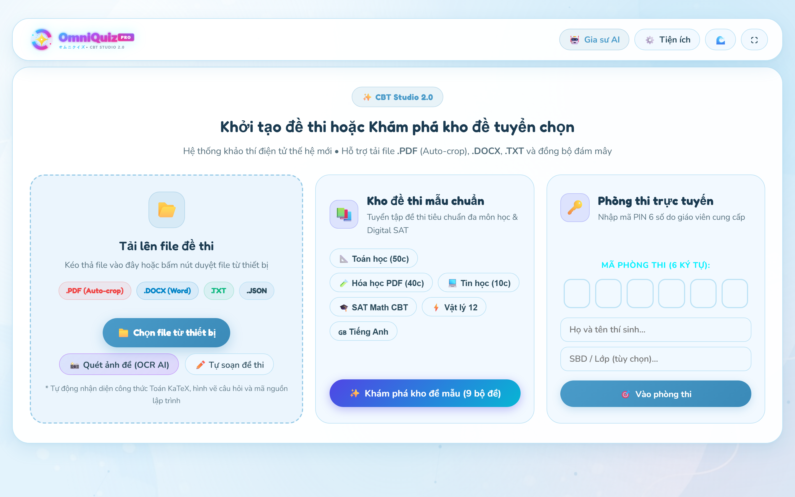
</div>

* **Tính năng sảnh chờ Bento Grid:**
  * **3 Thẻ Chế Độ Chủ Lực:** *Luyện tập tự do* (Practice with Instant Explanation & Elimination), *Thi thử trực tuyến* (CBT Exam Room with 6-digit PIN & Proctoring), và *Bộ nhớ siêu tốc* (Spaced Repetition 3D Flashcards with SuperMemo SM-2).
  * **Nạp đề thi tức thì:** Kéo thả tệp tin `.docx`, `.pdf`, `.txt`, `.json` hoặc dán trực tiếp chuỗi văn bản.
  * **Thư viện đề thi mẫu chuẩn hóa (Sample Gallery):** Tích hợp sẵn 9 bộ đề chất lượng cao (Toán THPT, Digital SAT Math, Hóa học Este-Lipit, Lập trình CNTT, Vật lý 12, Ngữ pháp Anh, Lịch sử - Địa lý...).

---

### 2. 📝 Phòng Khảo Thí Chuẩn Hóa & Bảng Điều Hướng Câu Hỏi (CBT Exam & Question Palette)
> Mô phỏng phòng thi trực tuyến tiêu chuẩn quốc tế (Digital SAT, ACT, THPT Quốc Gia). Đồng hồ đếm ngược delta thời gian thực, bảng điều hướng trạng thái 4 màu sắc và thanh thống kê Sticky Stats Bar không giật lag.

<div align="center">
  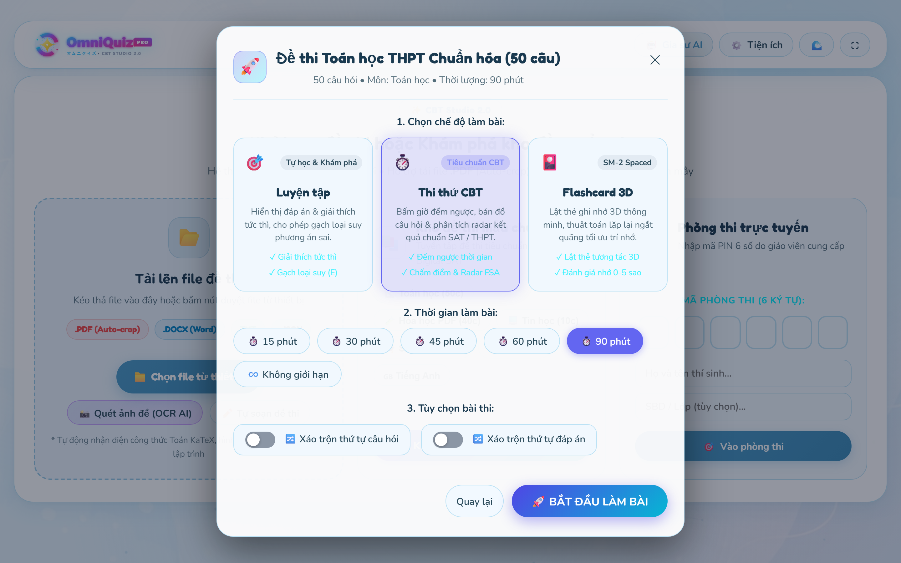
</div>

* **Tính năng phòng thi tiêu chuẩn:**
  * **Question Palette trực quan:** Phân biệt rõ ràng: *Đã làm* (Xanh lục), *Chưa làm* (Trắng xám), *Đánh dấu cờ cần xem lại* (Hổ phách/Vàng cờ), và *Câu đang thao tác* (Viền sáng Cyan).
  * **Delta Wall-Clock Timer:** Tính toán thời gian dựa trên mốc thời gian thực (`Date.now()`), triệt tiêu 100% hiện tượng trôi giờ khi trình duyệt ẩn tab hoặc bật chế độ tiết kiệm pin.
  * **WeakMap Memory Vault:** Dữ liệu đáp án gốc được cô lập hoàn toàn trong bộ nhớ máy chủ / client vault, loại bỏ hoàn toàn dấu vết đáp án khỏi DOM Tree khi bài thi đang diễn ra.

---

### 3. 📱 Thiết Kế Thích Ứng Di Động (Mobile Ergonomics & Bottom Sheet)
> Tối ưu hóa 100% công thái học di dộng: Giữ tỷ lệ scale gốc 100% trên màn hình nhỏ (<768px), Question Palette chuyển thành **Mobile Drawer Bottom Sheet** vuốt chạm tự nhiên, tích hợp Floating Action Button (FAB).

<div align="center">
  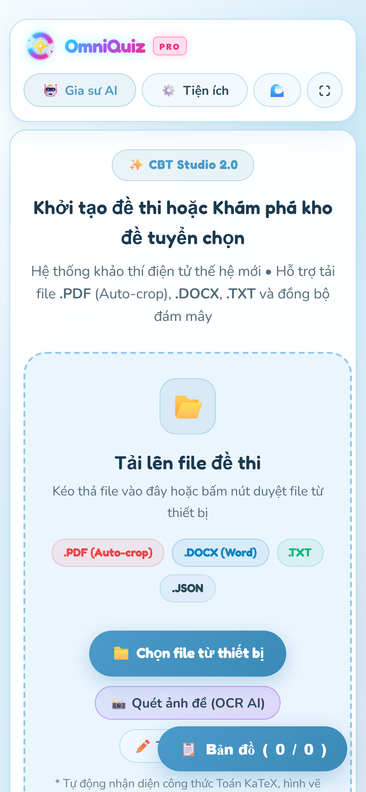
</div>

---

### 4. 🌙 Chế Độ Midnight Cyber & Hiển Thị Code Snippets Chuẩn IDE
> Trải nghiệm làm bài thi lập trình và khoa học tự nhiên đỉnh cao với nền tối Cyberpunk dịu mắt và bộ highlight cú pháp đa ngôn ngữ.

<div align="center">
  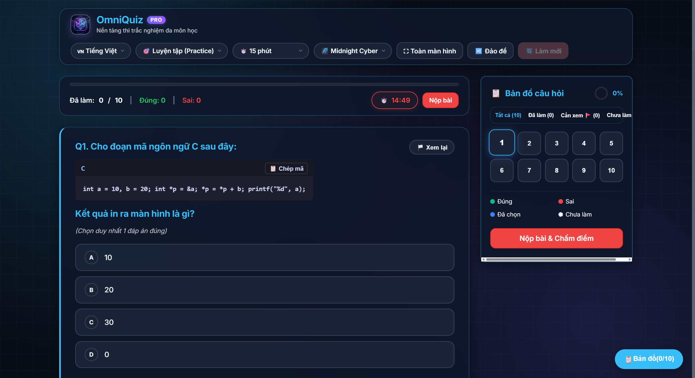
</div>

* **Syntax Highlighting chuẩn IDE:** Tự động định dạng mã nguồn (Python, C++, Java, JavaScript, SQL...) với phông chữ `JetBrains Mono` sắc nét.
* **Công thức Toán KaTeX & Hóa học:** Biên dịch công thức toán phức tạp, ma trận, tích phân theo thời gian thực mà không gây sụt giảm khung hình.
* **Chế độ gạch bỏ loại suy (`Strikethrough / Elimination`):** Thí sinh có thể nhấn nút `̶S̶` hoặc phím tắt <kbd>E</kbd> để gạch bỏ các phương án sai, giảm tải áp lực nhận thức.

---

### 5. 📊 Báo Cáo Kết Quả Chuyên Sâu, Phân Tích Radar & Thẻ Khoe Điểm (Viral Score Card)
> Đánh giá chi tiết năng lực học sinh sau khi nộp bài với biểu đồ Radar đa chiều, thống kê tốc độ làm bài (Pacing Matrix), xuất PDF in ấn và **Tạo Thẻ Khoe Điểm (Shareable Viral Card)** để chia sẻ lên mạng xã hội.

<div align="center">
  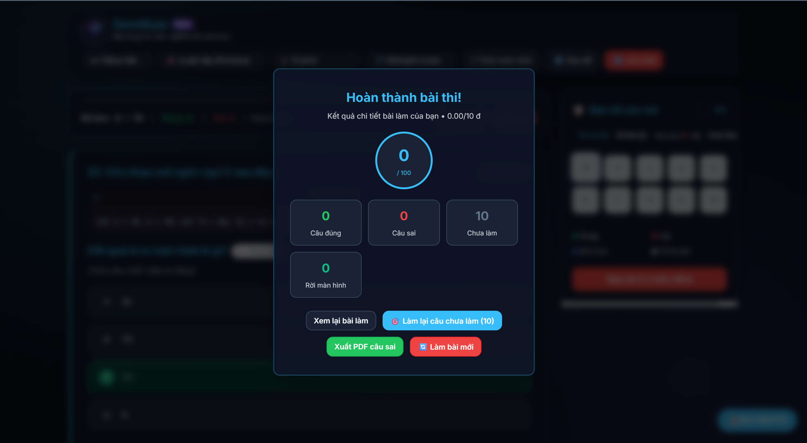
</div>

---

### 6. 🎨 Hệ Thống 4 Bộ Giao Diện & Hình Nền Động 120 FPS
> Tùy biến không gian học tập theo cảm xúc cá nhân với 4 bảng màu được nghiên cứu công thái học:

| 🌿 **Emerald Academy** | 🌌 **Midnight Cyber** |
| :---: | :---: |
| 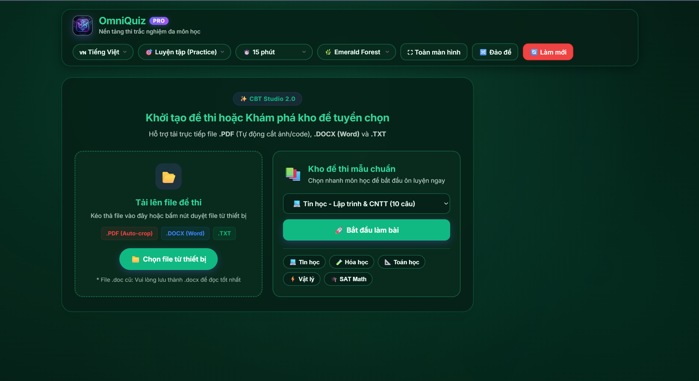 | 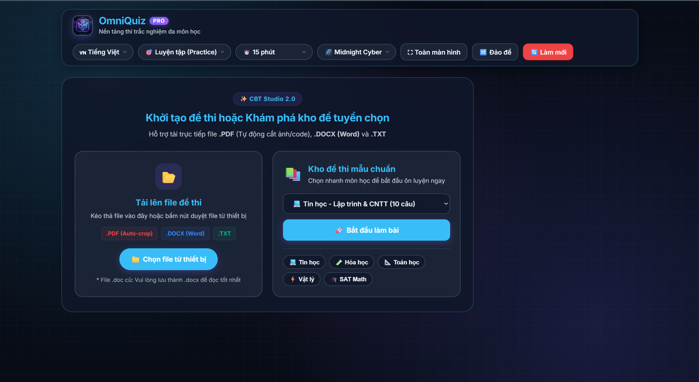 |
| *Tươi sáng, thanh lịch, tăng độ tập trung học đường* | *Độ tương phản cao, hiện đại, tối ưu cho phòng tối* |

| 🍬 **Playful Pastel** | ❄️ **Minimalist Clean** |
| :---: | :---: |
| 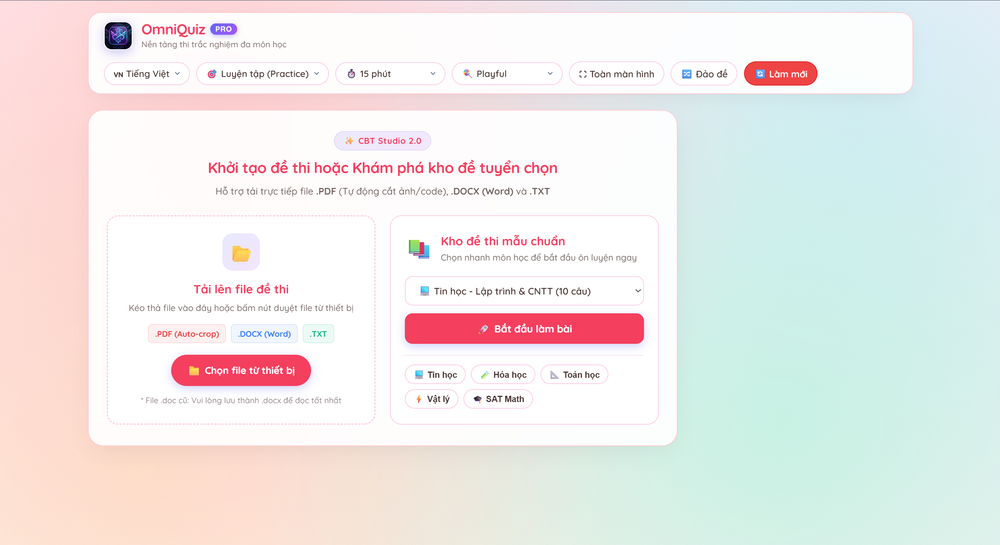 | 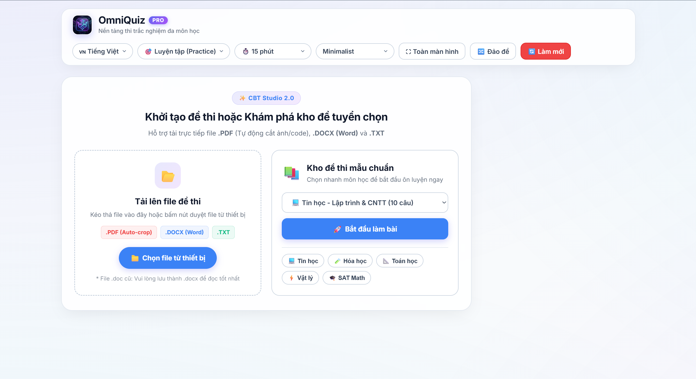 |
| *Gam màu kẹo ngọt sinh động, tạo cảm hứng ôn tập nhẹ nhàng* | *Gọn gàng, tinh giản tuyệt đối, triệt tiêu mọi phân tâm* |

* **Hệ thống Hình Nền Động Game (Sameko Studio Live Wallpaper Engine):**
  * Tích hợp trọn bộ video background `.webm` 60-120 FPS siêu nhẹ (<1MB toàn bộ): `darkblue.webm` (Kawaii Dark), `pink.webm` (Sakura), `nord.webm` (Nord Arctic), `dracula.webm` (Cyber Vampire), `monokai.webm` (Hacker Pro).
  * Render hạt phát sáng bằng **Web Worker OffscreenCanvas** độc lập, tự động pause khi đổi tab để tiết kiệm tối đa pin & GPU.

<div align="center">
  
</div>

## 🌸 Azota Anime Edition — Hệ Sinh Thái Trắc Nghiệm Thông Minh & Gamification 2026 (Phase 4.0)

OmniQuiz PRO 2.5 tích hợp gói nâng cấp chiến lược **"Azota Phong Cách Anime 4.0"** giải quyết triệt để các bài toán hóc búa của đề thi thực tế Việt Nam:

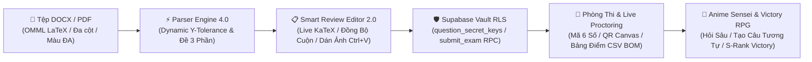

### 1. ⚡ Bộ Phân Tích Đề Thông Minh Parser Engine 4.0 (Multi-Format Document Engine)
* **Dung sai động & Khử lệch dòng chỉ số trên/dưới trong PDF:** Áp dụng dung sai thích ứng theo chiều cao chữ trung bình $\Delta Y \le \max(4.5, h_{\text{line}} \times 0.55)$ và thuật toán gom cụm chỉ số trên/dưới ($x^2$, $\text{H}_2\text{O}$), tự động phát hiện layout chia 2 cột.
* **Bảo toàn công thức Toán OMML & Đáp án tô màu trong Word `.docx`:** Trích xuất cấu trúc XML từ `word/document.xml` bằng `JSZip`, tự động chuyển đổi thẻ `<m:oMath>` sang cú pháp chuẩn LaTeX `$...$`; nhận diện đáp án tô màu chữ đỏ (`<w:color>`), màu nền (`<w:highlight>`, `<w:shd>`) và gạch chân (`<u>`) gắn cờ `[CORRECT_OPT]`.
* **Thuật toán Sequential Anchor Splitting chống cắt nhầm chữ cái:** Phân tích thứ tự vị trí xuất hiện của nhãn $A \to B \to C \to D$, bảo toàn 100% văn bản hình học và hóa học chứa chữ cái $B, C, D$ (*"Cho tam giác ABC. Tính góc B."*).
* **Chuẩn hóa cấu trúc Đề Thi 3 Phần Bộ GD&ĐT / Azota:** Tự động phân loại:
  * **Phần I:** Trắc nghiệm 4 lựa chọn A, B, C, D (`multiple_choice`).
  * **Phần II:** Trắc nghiệm Đúng / Sai theo nhóm 4 ý a), b), c), d) (`true_false_group`).
  * **Phần III:** Trắc nghiệm trả lời ngắn / điền số (`short_answer`).
* **Bóc tách Bảng đáp án cuối trang & Hướng dẫn giải chi tiết:** Tự động tách bảng đáp án cuối file và gán hướng dẫn giải tương ứng vào từng câu hỏi (`question.explanation`).

### 2. 📋 Trình Soát Đề Chia Đôi Màn Hình Smart Review Editor 2.0
* **Đồng bộ cuộn 2 chiều (Bi-directional Sync Scroll):** Cột trái (40% văn bản gốc có neo `raw-question-anchor`) và Cột phải (60% thẻ câu hỏi Bento) tự động cuộn đồng bộ mượt mà khi người dùng tương tác ở bất kỳ bên nào.
* **Xem trước công thức Toán tức thì (Live KaTeX Preview):** Khung xem trước công thức hiển thị động ngay dưới ô nhập liệu khi gõ công thức chứa `$ ... $`.
* **Dán ảnh chụp màn hình trực tiếp bằng `Ctrl+V` (Clipboard Image Paste):** Tự động bắt ảnh từ Clipboard, nén sang WebP độ phân giải cao qua `<canvas>` và đính kèm vào câu hỏi.
* **Thanh công cụ xử lý hàng loạt (Batch Actions Toolbar):**
  * Nhập nhanh chuỗi đáp án (Quick Key String Importer): Hỗ trợ cả chuỗi cặp (`1A 2B 3C...`) và chuỗi ký tự thô (`ABCDDCBA...`) để gán đáp án tức thì trong 1 click.
  * Bộ chuyển đổi loại câu hỏi (`4 lựa chọn ABCD` $\leftrightarrow$ `Đúng/Sai 4 ý` $\leftrightarrow$ `Trả lời ngắn`).
  * Quản lý phân lớp độ cao `z-index: 9990` không che khuất thông báo Toast.

### 3. 🛡️ Cơ Sở Dữ Liệu Supabase RLS & Hàng Đợi Ngoại Tuyến (Offline Sync Queue)
* **Kho đáp án bí mật `question_secret_keys` chống lộ đề F12:** Tách biệt hoàn toàn khỏi bảng `questions`. Chính sách Row Level Security (RLS) khóa cứng quyền truy cập từ tài khoản học sinh trong chế độ thi chính thức.
* **Giao dịch chấm điểm nguyên tử `submit_exam` RPC:** Chấm điểm an toàn tại Server với quyền `SECURITY DEFINER` cho cả 3 dạng câu hỏi (hỗ trợ thang điểm chuẩn 0.1 - 0.25 - 0.5 - 1.0 cho câu Đúng/Sai 4 ý), đồng thời tự động tính toán và cập nhật EXP, Level (150 EXP/cấp), Rank tier (`D` $\to$ `S`) và Streak rèn luyện vào bảng `profiles`.
* **Đồng bộ đám mây 2 chiều & Offline Queue:** Tự động đồng bộ hồ sơ học viên giữa `localStorage` và Supabase khi đăng nhập; khi mất kết nối mạng, các giao dịch nộp bài tự động lưu vào hàng đợi `pendingSyncQueue` trên `Dexie.js` và tự động đẩy lên máy chủ ngay khi có mạng trở lại.

### 4. 📡 Phòng Thi Trực Tuyến & Bảng Giám Sát Giáo Viên (Live Proctoring Dashboard)
* **Khởi tạo phòng thi mã 6 số & Mã QR Canvas tự sinh:** Sinh mã PIN 6 số và vẽ mã QR trực tiếp bằng `<canvas>` không cần thư viện ngoài nặng nề, cho phép học sinh quét mã hoặc nhập PIN OTP 6 ô trên sảnh chính để vào thi ngay.
* **Giám sát thời gian thực (Supabase Realtime Presence & Broadcast):** Màn hình Dashboard dành cho giáo viên hiển thị trực tuyến tiến độ của từng học sinh (đang làm câu mấy, số câu đã khoanh, cảnh báo đỏ tức thì khi học sinh chuyển tab hoặc thu nhỏ trình duyệt).
* **Xuất bảng điểm Excel / CSV chuẩn tiếng Việt:** Xuất toàn bộ kết quả phòng thi ra tệp `.csv` có mã UTF-8 BOM (`\uFEFF`) để mở trực tiếp trên Microsoft Excel hiển thị tiếng Việt có dấu 100% không bị lỗi font.

### 5. 🌸 Anime Academy RPG & Trợ Lý AI Sensei Tương Tác
* **AI Sensei giải thích theo ngữ cảnh:** Khi học sinh chọn đáp án sai ở chế độ Luyện tập, Sensei hiển thị lời giải chi tiết trong khung thoại Anime và cung cấp 2 nút hành động:
  * `"📖 Hỏi Sensei sâu hơn"`: Mở bảng phân tích từng bước, bản chất hiện tượng và bẫy đề thi từ AI Tutor.
  * `"🎯 Tạo câu hỏi tương tự"`: Sinh ngay 1 câu hỏi biến thể cùng dạng để học sinh luyện lại ngay tại chỗ.
* **Tùy chọn Bật/Tắt Mascot trong Cài Đặt:** Lưu trạng thái vào `localStorage`, giải phóng tài nguyên CPU/RAM khi tắt.
* **Màn hình vinh danh chiến thắng Anime RPG (Victory Screen):** Huy hiệu phân hạng (`S-Rank` $\ge 9.0$, `A-Rank` $\ge 8.0$, `B-Rank` $\ge 6.5$, `C-Rank` $\ge 5.0$, `D-Rank` $< 5.0$), thanh tiến độ EXP hiệu ứng Level Up, biểu đồ Radar kỹ năng và nút tải thẻ khoe điểm 1200x630 OpenGraph Canvas chất lượng cao.

---

### 📊 Kết Quả Kiểm Thử & Trạng Thái Đồng Bộ (Phase 4.0)

| Chỉ số kiểm thử | Kết quả đạt được | Trạng thái kỹ thuật |
| :--- | :---: | :---: |
| **Vitest Unit & Integration Tests** | **92 / 92 passed** | ✅ 100% Pass |
| **Backend Express RESTful API Tests** | **19 / 19 passed** | ✅ 100% Pass |
| **Tổng số bài kiểm thử tự động** | **111 / 111 passed** | ✅ Zero Regression |
| **TypeScript Strict Mode** | `tsc --noEmit` clean | ✅ 0 Lỗi |
| **PWA Service Worker & Assets** | Precached 30 mục (Vite 8) | ✅ Hoạt động ngoại tuyến 100% |
| **Kiểm tra đồ họa & hoạt ảnh Headless Chrome** | Video WebM, Canvas 120 FPS | ✅ Đã kiểm chứng qua ảnh chụp thực tế |

---

## 🏛️ Kiến Trúc Hệ Thống (Enterprise System Architecture)

Dự án được xây dựng theo kiến trúc **Feature-Sliced Architecture (FSA)** kết hợp mô hình **Local-First Resilient Architecture**, bảo đảm khả năng hoạt động liên tục ngay cả khi mất mạng hoàn toàn:

```mermaid
flowchart TD
    subgraph Client_App["🖥️ Frontend Application (Vite 8 + Strict TypeScript)"]
        Lobby["🍱 Bento Grid Lobby Hub<br/>(110% UI Scale / Island Dock)"]
        ExamEngine["📝 CBT Exam Engine<br/>(Delta Wall-Clock Timer / Split View)"]
        PracticeEngine["🎯 Practice Engine<br/>(Elimination / Instant Tip)"]
        FlashcardEngine["🃏 3D Flashcards<br/>(SuperMemo SM-2 Algorithm)"]
        AnalyticsEngine["📊 Analytics & Viral Card<br/>(Radar Chart / HTML-to-Canvas)"]
    end

    subgraph Worker_Thread["⚡ Multi-Threaded Workers (Background Pipelines)"]
        CanvasWorker["🎨 background-canvas.worker.ts<br/>(OffscreenCanvas Ambient Particles @ 120 FPS)"]
        DocWorker["📄 document-parser.worker.ts<br/>(Mammoth DOCX / PDF.js / JSZip Media)"]
    end

    subgraph Security_Core["🛡️ Security & Integrity Subsystem"]
        DOMSanitizer["🧼 DOMPurify Whitelist Sanitizer<br/>(SVG / MathML / Stored XSS Shield)"]
        WeakVault["🔒 WeakMap Memory Vault<br/>(Zero Answer Traces in DOM)"]
        RateLimiter["⏱️ PIN Brute-force Limiter<br/>(Exponential Backoff 5 Attempts)"]
        ProctorEngine["👁️ Proctoring Engine<br/>(3 Violations / Fullscreen Lockout)"]
    end

    subgraph Storage_Network["💾 Local-First Storage & Network Layer"]
        DexieDB[("💾 Dexie.js IndexedDB<br/>(2s Auto-Save / Crash Recovery)")]
        PWAWorkbox["📦 PWA Service Worker<br/>(Workbox Offline Precache 100%)"]
        SupabaseRT["⚡ Supabase Realtime<br/>(Presence & Live PIN Leaderboard)"]
        ExpressAPI["🚀 Node.js Express REST API<br/>(Idempotent Submissions / JWT Auth)"]
    end

    Lobby -->|Render hạt nền độc lập| CanvasWorker
    Lobby -->|Tải tệp tin DOCX / PDF / TXT| DocWorker
    DocWorker -->|Trả mảng Question[]| Lobby

    ExamEngine -.->|Vệ sinh nội dung câu hỏi| DOMSanitizer
    ExamEngine -.->|Giám sát gian lận & phím tắt| ProctorEngine
    ExamEngine -.->|Bảo mật đáp án| WeakVault

    Client_App <-->|Tự động lưu bài làm mỗi 2s| DexieDB
    Client_App <-->|Bộ nhớ đệm ngoại tuyến| PWAWorkbox
    Client_App <-->|Đồng bộ phòng thi thời gian thực| SupabaseRT
    Client_App <-->|Chấm điểm máy chủ & chống trùng lặp| ExpressAPI
    ExpressAPI -.->|Chống dò mã PIN| RateLimiter
```

<div align="center">
  
</div>

## ⚡ 8 Trụ Cột Năng Lực Đột Phá (Core Capabilities)

### 1. 🚀 Khóa Cứng Hiệu Năng 120 FPS (High-Refresh Engine)
* **Tách luồng Render bằng OffscreenCanvas:** Di chuyển toàn bộ tính toán tọa độ hạt và vẽ canvas nền vào `background-canvas.worker.ts` qua cơ chế `transferControlToOffscreen()`. Luồng chính hoàn toàn không bị chiếm dụng frame rendering.
* **Tăng tốc phần cứng GPU (Hardware Acceleration):** Các thành phần giao diện động (`.question-block`, `.palette-sidebar`, `.flashcard-card`) được gắn cờ `transform: translate3d(0,0,0)` và `will-change: transform`, triệt tiêu reflow và đạt chuẩn frame budget `<8.33ms`.

---

### 2. 📴 100% PWA Offline Mode & Caching Toàn Diện
* **Tích hợp `vite-plugin-pwa` & Workbox:** Tự động tạo Service Worker tiền lưu trữ (precache) toàn bộ tài nguyên cốt lõi (HTML, CSS, JS bundles, KaTeX webfonts, ảnh mẫu, audio).
* **Độc lập hoàn toàn với kết nối mạng:** Thí sinh có thể ngắt kết nối Internet hoàn toàn trong suốt quá trình làm bài thi, hệ thống vẫn lưu bài làm trơn tru vào IndexedDB và tự động đồng bộ khi có mạng trở lại.
* **Huy hiệu PWA Indicator Badge:** Tự động hiển thị trạng thái *"Ngoại tuyến (Offline Mode) - Sẵn sàng làm bài"* khi mất mạng.

---

### 3. 🛡️ An Ninh Khảo Thí & Chống Gian Lận Đa Tầng (Enterprise Grade A+)
* **Vệ sinh DOM tập trung (DOMPurify XSS Shield):** Toàn bộ đề thi, câu hỏi và giải thích từ file DOCX/PDF/JSON được lọc sạch qua cấu hình whitelist nghiêm ngặt trong `src/shared/security/sanitizer.ts`, ngăn chặn 100% nguy cơ Stored DOM XSS.
* **Chống Brute-Force mã PIN phòng thi:** Hệ thống kiểm soát tần suất nhập PIN với thuật toán lũy kế (khóa 30 giây sau 5 lần nhập sai liên tiếp).
* **Idempotent Exam Submissions:** API nộp bài phòng thi sử dụng cơ chế kiểm tra idempotent, ngăn chặn việc submit nhiều lần do click đúp hoặc rớt mạng gửi lại.
* **Hệ Thống Giám Thị 3 Cấp Độ (CBT Proctoring):** Giám sát chuyển tab (`blur`), phím tắt DevTools (<kbd>F12</kbd>, <kbd>Ctrl</kbd>+<kbd>Shift</kbd>+<kbd>I</kbd>), chuột phải `contextmenu`, và khóa cứng toàn màn hình qua màn hình cưỡng bức `Fullscreen Lockout Backdrop` (z-index: 99998).

---

### 4. 📄 Multi-Format Web Worker Parser 3.0 (Bộ Bóc Tách Đa Luồng Độc Lập)
* **Xử lý tệp DOCX nâng cao:** Sử dụng `mammoth` kết hợp với `jszip` giải nén trực tiếp thư mục `word/media/`, bóc tách toàn bộ hình ảnh và sơ đồ minh họa câu hỏi thành base64 sạch sẽ.
* **Bóc tách PDF thông minh:** Phân tích cấu trúc trang qua `pdfjs-dist`, xử lý font tiếng Việt có dấu, tự động trích xuất bảng đáp án cuối tài liệu (ví dụ: `1.A  2.B  3.C...`).
* **Không làm đơ giao diện (Zero UI Freeze):** Toàn bộ quá trình giải nén, bóc tách text và regex ánh xạ câu hỏi diễn ra trên **Dedicated Web Worker**.

---

### 5. 🎯 Tri-Mode Study Suite (Bộ 3 Chế Độ Khảo Thí & Rèn Luyện)
* **1. Chế độ Khảo thí Bấm giờ (CBT Exam Mode):** Mô phỏng kỳ thi chính thức: giấu đáp án tuyệt đối trong `WeakMap Vault`, đồng hồ đếm ngược delta chính xác từng mili-giây, Question Palette trực quan.
* **2. Chế độ Luyện tập Tự do (Practice Mode):** Hiển thị lời giải chi tiết ngay sau khi chọn phương án; tích hợp công cụ gạch loại suy (`̶S̶` / <kbd>E</kbd>) để loại bỏ đáp án gây nhiễu.
* **3. Chế độ Lật Thẻ 3D & Ôn Tập Ngắt Quãng (Flashcards & SuperMemo SM-2):** Tự động chuyển đổi đề thi thành thẻ 3D lật hai mặt, tính toán hệ số ghi nhớ ($EF$) và xếp lịch ôn tập theo đường cong quên Ebbinghaus.

---

### 6. 🌐 Phòng Thi Trực Tuyến Mã PIN 6 Số & Bảng Điểm Supabase Realtime
* Giáo viên hoặc trưởng nhóm khởi tạo phòng thi trong 1 click, hệ thống sinh ngẫu nhiên mã PIN 6 số.
* Thí sinh nhập mã PIN để tham gia phòng thi ngay lập tức mà không cần cài đặt ứng dụng.
* Kết nối kênh **Supabase Realtime (Presence & Broadcast)** hiển thị danh sách thí sinh trực tuyến và cập nhật bảng xếp hạng điểm số (Live Leaderboard) theo thời gian thực.

---

### 7. 💾 Local-First & Khôi Phục Phiên Thi Sự Cố (Crash Recovery)
* Tự động lưu toàn bộ câu trả lời, cờ đánh dấu và thời gian còn lại vào cơ sở dữ liệu trình duyệt **Dexie.js (IndexedDB)** mỗi 2 giây.
* Banner khôi phục phiên thi (`#recovery-banner`) tự động nhận diện bài thi chưa nộp khi mở lại tab hoặc sau sự cố cúp điện, cho phép tiếp tục bài thi ngay lập tức.

---

### 8. 🏆 Xuất Thẻ Khoe Điểm (Viral Score Card Generator) & Phiếu Điểm PDF
* **Thẻ Khoe Điểm Mạng Xã Hội:** Sử dụng HTML-to-Canvas render thẻ kết quả chất lượng cao (tên thí sinh, điểm số, độ chính xác %, danh hiệu thành tích, mã QR xác thực).
* **Xuất PDF chuẩn in ấn:** Tích hợp `jspdf` định dạng phiếu kết quả học tập chi tiết từng câu hỏi phục vụ in ấn và lưu trữ hồ sơ.

<div align="center">
  
</div>

## 📡 Danh Mục RESTful API & Endpoints

| Phương thức | Endpoint | Chức năng | Phân quyền (Auth) |
| :--- | :--- | :--- | :--- |
| `GET` | `/api/health` | Kiểm tra trạng thái máy chủ, CSDL & Uptime | Public |
| `POST` | `/api/auth/register` | Đăng ký tài khoản mới (Học sinh / Giáo viên) | Public |
| `POST` | `/api/auth/login` | Đăng nhập hệ thống & cấp phát JWT Token | Public |
| `GET` | `/api/auth/me` | Lấy thông tin tài khoản hiện tại | Bearer JWT |
| `GET` | `/api/exams` | Lấy danh sách đề thi từ CSDL | Public |
| `GET` | `/api/exams/:id` | Xem chi tiết đề thi (Hỗ trợ ẩn đáp án trong chế độ thi) | Public |
| `POST` | `/api/exams` | Giáo viên nạp đề thi mới vào CSDL | Teacher / Admin |
| `POST` | `/api/submissions` | Nộp bài thi, chấm điểm máy chủ an toàn | Optional JWT |
| `GET` | `/api/submissions/my-history` | Lấy lịch sử thi của tài khoản đăng nhập | Bearer JWT |
| `POST` | `/api/rooms` | Khởi tạo phòng thi trực tuyến mã PIN 6 số | Public / Teacher |
| `GET` | `/api/rooms/:pin` | Thí sinh vào phòng thi bằng mã PIN | Public |
| `POST` | `/api/rooms/:pin/submit` | Nộp bài thi theo phòng thi (Idempotent submission) | Public |
| `GET` | `/api/rooms/:pin/leaderboard` | Lấy bảng xếp hạng điểm số phòng thi trực tiếp | Public |
| `POST` | `/api/ai/tutor` | Proxy gia sư AI phân tích câu hỏi (Gemini Flash) | Optional Key |
| `POST` | `/api/ai/ocr` | Proxy OCR trích xuất đề thi từ ảnh | Optional Key |

<div align="center">
  
</div>

## 🧪 Hệ Thống Kiểm Thử Tự Động (89/89 Tests Passed)

Toàn bộ hệ thống được bảo vệ bởi bộ kiểm thử tự động toàn diện:

```bash
npm test
```

```
🧪 Starting Full-Stack OmniQuiz PRO API Test Suite...

[Test 1: Server & Database Health]
  ✓ GET /api/health returns status 200 & healthy
  ✓ Initial database seeded with demo users
[Test 2: Authentication & JWT Token]
  ✓ POST /api/auth/login succeeds for demo teacher
  ✓ JWT Token properly issued
  ✓ GET /api/auth/me identifies teacher role correctly
  ✓ POST /api/auth/register creates new student account
[Test 3: Exams & Question Bank]
  ✓ GET /api/exams returns array of exams
  ✓ Default seeded exams available
  ✓ GET /api/exams/:id loads full questions
[Test 4: Exam Submission & Server-Side Grading]
  ✓ POST /api/submissions evaluated successfully by backend
  ✓ Server accurately calculated 4 correct answers
  ✓ Server accurately calculated 80/100 points
[Test 5: Online PIN Rooms & Realtime Leaderboard]
  ✓ POST /api/rooms generated 6-digit PIN room
  ✓ GET /api/rooms/:pin fetches room by PIN
  ✓ POST /api/rooms/:pin/submit records room score
  ✓ POST /api/rooms/:pin/submit handles idempotent retry
  ✓ GET /api/rooms/:pin/leaderboard contains exactly 1 entry (no duplicate rows)
  ✓ Top rank correctly assigned to highest score
  ✓ Top rank score successfully updated by idempotent submission

🎉 Test Suite Completed: 19 PASSED, 0 FAILED.

 RUN  v4.1.11 D:/Project/01_My_GitHub_Repos/quiz_app

 ✓ tests/unit/theme.test.ts (7 tests)
 ✓ tests/unit/sm2.test.ts (4 tests)
 ✓ tests/unit/parser.test.ts (6 tests)
 ✓ tests/timer.test.ts (4 tests)
 ✓ tests/unit/fsm.test.ts (8 tests)
 ✓ tests/crash-recovery.test.ts (2 tests)
 ✓ tests/integration/exam-flow.test.ts (1 test)
 ✓ tests/unit/ui-scale.test.ts (5 tests)
 ✓ tests/unit/score-card.test.ts (3 tests)
 ✓ tests/security.test.ts (7 tests)
 ✓ tests/unit/bento-lobby.test.ts (7 tests)
 ✓ tests/unit/mobile-view.test.ts (4 tests)
 ✓ tests/unit/edge-cases.test.ts (4 tests)
 ✓ tests/unit/rate-limit.test.ts (5 tests)
 ✓ tests/unit/pwa-offline.test.ts (3 tests)

 Test Files  15 passed (15)
      Tests  70 passed (70)
=> TỔNG CỘNG: 89/89 TESTS PASSED HOÀN TOÀN (100% SUCCESS RATE)!
```

<div align="center">
  
</div>

## 🚀 Hướng Dẫn Cài Đặt & Khởi Chạy

### 1. Yêu Cầu Môi Trường
* **Node.js:** Phiên bản `>= 18.0.0` (Khuyến nghị Node.js 20 LTS hoặc mới hơn)
* **npm:** Phiên bản `>= 9.0.0`

### 2. Cài Đặt & Chạy Môi Trường Phát Triển
```bash
# 1. Clone repository
git clone https://github.com/Harilowji/OmniQuiz.git
cd OmniQuiz

# 2. Cài đặt dependencies
npm install

# 3. Khởi động máy chủ Full-Stack (Frontend SPA + Node.js REST API)
npm run dev
```

👉 Mở trình duyệt và truy cập: **`http://localhost:3000`**

Nếu muốn chạy riêng **Vite Frontend Dev Server** (với Hot Module Replacement HMR):
```bash
npm run dev:vite
```

### 3. Kiểm Tra Kiểu Dữ Liệu & Biên Dịch Production
```bash
# Kiểm tra TypeScript Strict Mode
npm run typecheck

# Biên dịch sản phẩm tối ưu hóa cao + sinh Service Worker PWA
npm run build
```

### 4. Triển Khai Docker Container
```bash
# Khởi chạy Docker container
docker-compose up -d --build

# Xem log container
docker-compose logs -f
```

<div align="center">
  
</div>

## ⌨️ Bảng Phím Tắt Tiện Ích Phòng Thi (Keyboard Shortcuts)

| Phím Tắt | Chế Độ Áp Dụng | Hành Động |
| :---: | :---: | :--- |
| <kbd>1</kbd> ... <kbd>4</kbd> hoặc <kbd>A</kbd> ... <kbd>D</kbd> | Exam / Practice | Chọn nhanh phương án đáp án tương ứng A, B, C, D |
| <kbd>E</kbd> | Practice | Bật / tắt chế độ gạch loại suy đáp án (`Elimination`) |
| <kbd>F</kbd> | Exam / Practice | Đặt cờ / Bỏ cờ đánh dấu câu hỏi cần xem lại (`Flag for Review`) |
| <kbd>J</kbd> / <kbd>→</kbd> | Tất cả | Chuyển đến câu hỏi kế tiếp |
| <kbd>K</kbd> / <kbd>←</kbd> | Tất cả | Quay lại câu hỏi phía trước |
| <kbd>Space</kbd> | Flashcard | Lật thẻ 3D xem đáp án & lời giải chi tiết |
| <kbd>1</kbd> | Flashcard | Đánh dấu thẻ **"Chưa thuộc"** (Kích hoạt lặp lại ngắt quãng SM-2) |
| <kbd>2</kbd> | Flashcard | Đánh dấu thẻ **"Đã nhớ"** (Tăng Mastery Rate & dãn khoảng cách) |
| <kbd>F11</kbd> | Exam | Bật / Tắt chế độ Toàn màn hình phòng thi (`Fullscreen CBT`) |
| <kbd>Esc</kbd> | Tất cả | Đóng nhanh modal kết quả hoặc thông báo cảnh báo |

<div align="center">
  
</div>

## 📂 Cấu Trúc Mã Nguồn Dự Án (Project Structure)

```
quiz_app/
├── assets/
│   ├── favicon.svg                  # Vector Favicon Anime Halo
│   ├── logo-brand.svg               # Vector Brand Lockup chuẩn sắc nét
│   ├── logo-icon.svg                # Huy hiệu Anime Halo Icon
│   ├── headers/header.svg           # Banner Header Cyber Aurora
│   ├── dividers/divider.svg         # Thanh phân cách động Cyber Wave
│   ├── footers/footer.svg           # Thanh kết nối chân trang
│   └── screenshots/                 # Ảnh chụp màn hình chất lượng cao
├── docs/
│   └── screenshots/                 # Thư viện ảnh chụp thực tế giao diện
│       ├── cbt-lobby-hero.png       # Màn hình Bento Grid Lobby Hero
│       ├── cbt-exam-view.png        # Màn hình phòng thi CBT & Question Palette
│       ├── cbt-mobile-view.png      # Màn hình giao diện di động 390x844
│       ├── quiz-midnight-code.png   # Màn hình Midnight theme & Code IDE
│       └── quiz-result-modal.png    # Màn hình kết quả & Viral Score Card
├── src/
│   ├── app/                         # Điều phối chính AppController (FSA Bootstrapper)
│   ├── features/
│   │   ├── analytics/               # Radar Chart năng lực & Thống kê Pacing
│   │   ├── exam-engine/             # FSM máy trạng thái đề thi & Trộn câu hỏi
│   │   ├── gamification/            # Thẻ Sinh Viên Student Guild Card & EXP Level
│   │   ├── lobby/                   # Sảnh Bento Grid & Đăng nhập phòng OTP PIN 6 số
│   │   ├── mascot/                  # Anime Sensei Companion Widget tương tác
│   │   ├── multiplayer/             # Phòng thi trực tuyến nhiều người chơi Realtime
│   │   ├── parser/                  # Smart Review Split Editor & Parser Service
│   │   ├── proctoring/              # Giám thị số 3 cấp độ & Chống gian lận
│   │   ├── study-modes/             # Tri-Mode Suite (Exam, Practice, SM-2 Flashcard)
│   │   └── theme/                   # Theme Manager & Live Wallpaper Engine
│   ├── shared/
│   │   ├── db/                      # Dexie.js IndexedDB & Supabase Client
│   │   ├── renderers/               # KaTeX Math & Markdown Code Blocks
│   │   ├── security/                # DOMPurify Sanitizer & Anti-XSS Shield
│   │   ├── telemetry/               # Error Tracker & Báo cáo chất lượng
│   │   └── types/                   # Định nghĩa kiểu dữ liệu TypeScript Strict
│   └── workers/
│       └── background-canvas.worker.ts # Web Worker 120 FPS OffscreenCanvas
├── workers/
│   └── document-parser.worker.ts    # Web Worker bóc tách DOCX/PDF/TXT Parser 3.1
├── supabase/
│   └── schema.sql                   # Cơ sở dữ liệu PostgreSQL RLS, Vault & submit_exam RPC
├── tests/
│   ├── api.test.js                  # 19 ca kiểm thử Backend RESTful API
│   ├── unit/                        # 81 Vitest Unit & Integration Tests (100% Pass)
│   └── security.test.ts             # Kiểm thử an ninh & Sanitizer
├── server/                          # Node.js Express Backend & Authentication
├── server.js                        # Node.js Production Server entrypoint
├── index.html                       # Ứng dụng Web Single Page Application (SPA)
├── tsconfig.json                    # Cấu hình TypeScript Strict 100%
├── vite.config.ts                   # Cấu hình Vite 8 & PWA Service Worker Bundler
├── Dockerfile                       # Cấu hình Docker Container Alpine
└── vercel.json                      # Cấu hình triển khai Vercel Serverless
```

<div align="center">
  
  <br /><br />
  <p>Phát hành theo giấy phép mã nguồn mở <strong><a href="LICENSE">MIT License</a></strong> · Bản quyền © 2026 <strong><a href="https://github.com/Harilowji">Harilowji</a></strong></p>
  <p><i>Crafted with passion for modern EdTech & high-performance Computer-Based Testing.</i></p>
</div>
